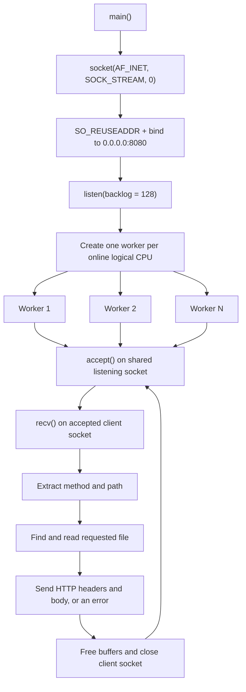
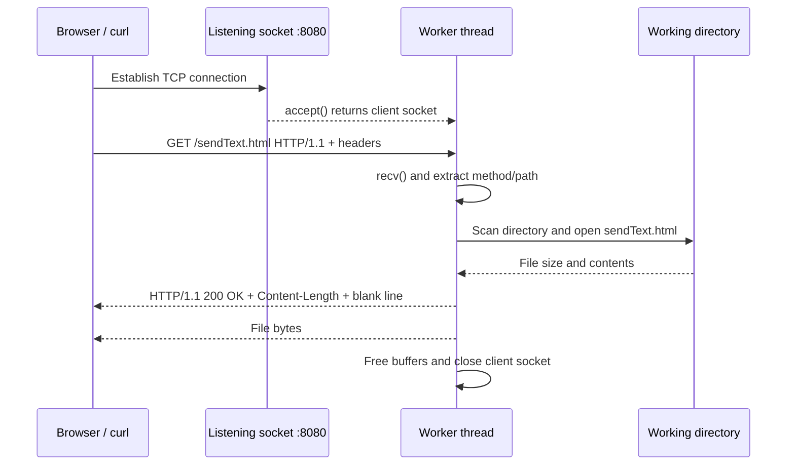

# HTTP Server in C

A small, multithreaded static file server built directly on POSIX sockets and pthreads. It makes the path from an HTTP request to a file response visible in a single C source file.

The project demonstrates TCP connections, socket setup, concurrent connection handling, basic request parsing, filesystem access, and HTTP response construction without a web framework or HTTP library.

## At a glance

| Component | Implementation |
| --- | --- |
| Language | C |
| Networking | IPv4 TCP sockets |
| Concurrency | Fixed worker pool using POSIX threads |
| Listening address | `0.0.0.0:8080` |
| File source | The directory from which the server is launched |
| Response format | HTTP/1.1 status line, `Content-Length`, and optional file body |
| Connection lifecycle | One request per accepted connection, followed by close |

## Implemented features

- **TCP socket lifecycle:** creates a socket, binds it to a local address, listens for connections, and accepts clients.
- **Address reuse:** enables `SO_REUSEADDR` before binding.
- **Concurrent connection handling:** creates one worker per online logical CPU reported by `sysconf(_SC_NPROCESSORS_ONLN)`. Workers share the listening socket and repeatedly accept connections.
- **Basic request parsing:** extracts the method and requested path from the received bytes.
- **Static file delivery:** matches the requested filename against entries in the working directory, opens the file, determines its size, and reads its contents into memory.
- **HTTP responses:** constructs response headers manually and sends the file body separately.
- **Error responses:** returns `400 Bad Request` when the method or path token is missing, and `404 File not found` when a matching entry cannot be found or opened.
- **Resource handling:** frees request and response buffers and closes the client connection after normal responses and several error paths. System and library failures are reported with `perror()` or `fprintf()`.
- **Sample page:** includes `sendText.html` for trying a complete request and response.

## Build and run

Use a POSIX environment with a C compiler and pthread support, such as Linux. No third-party libraries are required.

From the repository directory:

```bash
cc -std=c11 -Wall -Wextra -pthread socket.c -o socket
./socket
```

The repository includes a `socket` executable; rebuilding produces a binary for your own environment. The server runs in the foreground and does not print a startup banner. Stop it with **Ctrl+C**.

In another terminal, request the sample page:

```bash
curl -i http://127.0.0.1:8080/sendText.html
```

You can also open [the sample page](http://127.0.0.1:8080/sendText.html) in a browser. The server currently omits `Content-Type`, so browser handling of the response may vary; curl shows the headers and body directly.

To inspect an error response:

```bash
curl -i http://127.0.0.1:8080/does-not-exist.html
```

This returns `404 File not found` with `Content-Length: 0`.

> **File lookup:** launch the server from the directory containing the files you want to serve. `/sendText.html` resolves to `sendText.html` in that directory. `/` has no default index page, and nested paths such as `/assets/style.css` are not resolved.

## Server architecture

All server logic lives in [`socket.c`](socket.c). There are two main responsibilities:

| Function | Responsibility |
| --- | --- |
| `main()` | Configure the listening socket, create the worker pool, and wait for the workers with `pthread_join()`. |
| `thread_function()` | Repeatedly accept a client, receive and parse its request, locate a file, send a response, and close the client socket. |



### Listening sockets and client sockets

The **listening socket** is the server's shared entry point. `accept()` returns a separate **client socket** for an established connection. Workers receive request bytes and send response bytes through that client socket while the listening socket remains available for other connections.

Each worker handles one connection at a time. Once it finishes, it returns to `accept()`. The server creates the workers at startup; it does not create a new thread for every request. If all workers are busy, pending connections wait in the operating system's queue, subject to its limits. The configured listen backlog is `128`; this is separate from the number of workers.

## How an HTTP request travels through the server

TCP provides a stream of bytes between the client and server. HTTP gives those bytes meaning through a request line, headers, a blank line, and an optional body. This server implements a small part of that format to demonstrate file delivery.



### 1. The client connects and sends a request

A request for the sample page looks like this:

```http
GET /sendText.html HTTP/1.1
Host: 127.0.0.1:8080
Connection: close

```

The first line contains the **method** (`GET`), **request target** (`/sendText.html`), and **HTTP version** (`HTTP/1.1`). Headers follow, then an empty line marks the end of the header section. On the wire, HTTP/1.1 lines end with `\r\n`.

### 2. A worker receives and parses the bytes

After `accept()`, the worker allocates a 4,096-byte request buffer and calls `recv()` once, requesting up to 4,095 bytes. The remaining byte is used to terminate the received data as a C string.

`strtok()` splits the buffer on spaces to obtain the method and path. If either token is missing, the server sends `400 Bad Request`. The method is extracted but is not validated or used to choose behavior; request headers, the HTTP version, and request bodies are not parsed.

### 3. The path becomes a local filename

The worker advances past the path's first character, expecting it to be `/`. For `/sendText.html`, the remaining string is `sendText.html`.

It scans `opendir(".")` / `readdir()` results for an exact filename match, then calls `fopen()` on that name. A missing entry or failed open produces `404 File not found`. There is no URL decoding, query-string handling, route table, or recursive directory lookup.

### 4. The worker reads the file

The worker uses `fseek()` and `ftell()` to determine the file size, rewinds the file, allocates a buffer, and loads the contents with `fread()`. The entire file is held in memory before the response is sent.

### 5. The server constructs a response

For the included 288-byte sample file, the response headers are:

```http
HTTP/1.1 200 OK
Content-Length: 288

```

The blank line separates the headers from the HTML file bytes that follow. `Content-Length` describes the body size in bytes, allowing the client to determine how much body data to expect. If the file changes, its reported length changes with it.

The implementation uses one `send()` call for the headers and another for the file body. Error responses contain a status line, `Content-Length: 0`, and no body.

| Status | Trigger in this implementation | Body |
| --- | --- | --- |
| `200 OK` | A matching file is opened and read successfully. | File contents |
| `400 Bad Request` | The method or path token is missing. | Empty |
| `404 File not found` | No directory entry matches, or `fopen()` fails. | Empty |

### 6. The connection closes

The worker frees its buffers, closes the client socket, and returns to `accept()` to handle another connection. Although responses use an HTTP/1.1 status line, persistent connections and multiple requests on one connection are not implemented. The main thread waits for the workers, whose accept loops normally run indefinitely.

## Configuration in the source

There are no command-line flags or configuration files. These settings are defined in [`socket.c`](socket.c):

| Setting | Current value | Where it is selected |
| --- | --- | --- |
| Bind address | All local IPv4 interfaces | `INADDR_ANY` |
| Port | `8080` | `htons(8080)` |
| Listen backlog | `128` | `listen(listen_socket, 128)` |
| Worker count | Online logical CPU count | `sysconf(_SC_NPROCESSORS_ONLN)` |
| Request buffer | 4,096 bytes; one read of up to 4,095 bytes | Request allocation and `recv()` |
| Response header buffer | 4,096 bytes | Response allocation and `snprintf()` |
| Files served | Entries in the launch directory | `opendir(".")` and `fopen()` |

## Current limitations and learning opportunities

This is an educational implementation with a deliberately small HTTP feature set. The following details matter when reading or extending it:

- **TCP reads and writes can be partial.** A single `recv()` may return only part of a request, even when the request is small. The server does not read until the complete headers arrive, retry partial `send()` calls, or check send results.
- **Parsing is minimal.** The method, HTTP version, headers, and path structure are not validated. Methods other than `GET` follow the same file-serving path; `HEAD`, for example, does not get its required body-free behavior.
- **Parser state is shared.** `strtok()` maintains internal state and is not thread-safe. Concurrent workers can interfere with parsing; `strtok_r()` or an explicit parser would address this.
- **File serving has no dedicated document root.** The working directory determines which filenames are available. There is no access-control layer, regular-file check, directory-index handling, or MIME type detection.
- **Connections use blocking I/O.** There are no client timeouts; a slow client can occupy a worker. TLS, keep-alive, chunked transfer encoding, and request-body processing are not implemented.
- **Files are buffered in full.** Memory use grows with the sizes of files being served concurrently. File sizes are stored in an `int`, which also limits large-file handling.
- **Failure recovery is incomplete.** Some failures terminate a worker, some error paths do not release every resource, and file seek/size errors are not checked. There is no graceful shutdown handler or structured request logging.

Useful next steps include incremental request parsing, thread-safe tokenization, complete read/write loops, MIME headers, a controlled document root, and more thorough cleanup and error handling.

## Repository layout

```text
.
├── README.md       # Project overview and request-flow walkthrough
├── socket.c        # Socket setup, worker pool, parser, and file responses
├── socket          # Included compiled executable; rebuild locally
└── sendText.html   # Sample page served by the server
```
